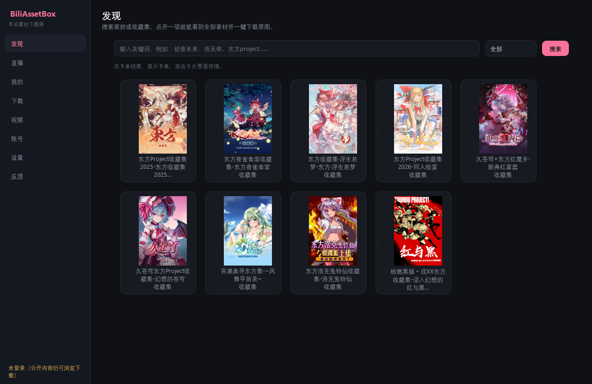

# B站素材盒子 · BiliAssetBox

一个把 B 站上**能公开浏览的素材**搬回自己硬盘的小工具：收藏集卡片原图、直播间表情、已拥有装扮的全套素材、视频。
C++ 负责所有网络与磁盘 I/O（编译成 `bili_core.dll`），Python + PySide6 负责界面，两边通过稳定的 C ABI（`ctypes`）通信。



> 只做个人备份用途。请遵守 B 站用户协议与著作权规定，不要二次分发、商用或批量搬运。

---

## 功能

| 模块 | 能拿到什么 | 登录 |
| --- | --- | --- |
| 发现 / 搜索 | 按关键词搜装扮与收藏集，点进去看全套素材 | 不需要 |
| 收藏集 | 每张卡的**无水印原图**（2–5 MB 的 PNG）+ 动态卡的 mp4 | 不需要 |
| 装扮详情 | 卡片、卡片背景、表情、加载动画、头像挂件、播放图标、皮肤、空间背景、点赞动效 | 不需要 |
| 直播间表情 | 指定房间的全部表情包，按包分目录 | 需要 |
| 我的 | 已拥有的装扮 / 收藏集卡片，双击进详情继续下载 | 需要 |
| 视频 | BV/av/链接 → 分 P + 清晰度 → DASH 下载 → ffmpeg 无损合并 mp4 | 高清档位需要 |
| 反馈 | 一键生成脱敏诊断包，附到 GitHub issue | 不需要 |

界面细节：深色主题、卡片网格可多选、缩略图异步加载并落盘缓存、任务页实时进度、断点续传、失败重试、自动跳过已下载文件。

## 运行依赖

| 依赖 | 是否必需 | 说明 |
| --- | --- | --- |
| Windows 10/11 x64 | 必需 | 内核用了 DPAPI、CreateProcessW、注册表代理探测 |
| `bili_core.dll` | 必需 | 打包版已内置；从源码跑时在 `build\bin` |
| **ffmpeg** | **只有视频下载必需** | DASH 的画面和声音是两个文件，合并成 mp4 只能靠它 |
| Python 3.10+ | 仅源码运行需要 | 双击 exe 的用户不用装 Python |

ffmpeg 的查找顺序：设置里手动指定的路径 → `PATH` → `%LOCALAPPDATA%\ffmpeg\bin`。exe 里**没有**内置 ffmpeg（否则体积要多 80–100 MB）。

没装 ffmpeg 的影响范围：收藏集、直播间表情、装扮素材、缩略图、反馈**全部正常**；只有「视频」页会直接失败，提示 `未找到 ffmpeg，请在设置里指定路径`。

---

## 架构

分两层：Python 画界面，C++ 管网络和磁盘，中间只通过 `bili_core.dll` 的 C ABI 通信（UTF-8 JSON 进，UTF-8 JSON 出）。

**界面层 — Python / PySide6**

| 文件 | 职责 |
| --- | --- |
| `gui/app.py` | 入口、日志、主题、异常兜底 |
| `gui/main_window.py` | 侧栏 + QStackedWidget + 会话状态 |
| `gui/pages/*.py` | 发现 / 直播 / 我的 / 下载 / 视频 / 账号 / 设置 / 反馈 |
| `gui/core_bridge.py` | ctypes 绑定、JobTracker（120ms 轮询）、设置读写 |

**内核层 — C++**

| 文件 | 职责 |
| --- | --- |
| `core/src/http.cpp` | libcurl(mbedTLS) + Cookie + 代理 + 断点续传 + 重试 |
| `core/src/ratelimit.cpp` | 接口/文件间隔、随机抖动、412/429 冷却、带宽上限 |
| `core/src/wbi.cpp` | WBI 签名（MIXIN_KEY_ENC_TAB + MD5） |
| `core/src/api.cpp` | 各业务接口 → 统一 JSON |
| `core/src/job.cpp` | 线程池下载、`.part` 原子改名、sha256 校验、ffmpeg 合并 |
| `core/src/feedback.cpp` | 诊断包 ZIP + 脱敏（自实现 crc32 / store 写入） |
| `core/src/abi.cpp` | 导出函数、异常防火墙、输出字符串 malloc / 释放 |

跨语言约定：

- **所有字符串都是 UTF-8 JSON**，`bc_*` 返回的 `char*` 必须用 `bc_free()` 释放，绝不跨语言抛异常；
- 每个导出函数内部 `try/catch(...)`，把错误压成错误码 + 线程局部错误 JSON（`bc_last_error`）；
- 下载进度不做回调，而是 `bc_job_poll` 拉事件队列 —— 避免 GIL / 重入 / 死锁这类跨语言事故；
- 错误码：`0` 成功、`-1` 参数、`-2` 网络、`-3` 解析、`-4` 登录、`-5` 磁盘、`-6` 校验、`-7` 取消、`-8` 不支持、`-99` 内部。

### 内核导出（`core/include/bili_core.h`）

```c
int   bc_init(const char* config_json, char** out);
const char* bc_version(void);
int   bc_call(const char* op, const char* args_json, char** out);
int   bc_job_create(const char* spec_json, int32_t* job_id, char** out);
int   bc_job_start(int32_t job_id, char** out);
int   bc_job_cancel(int32_t job_id, char** out);
int   bc_job_poll(int32_t job_id, int32_t timeout_ms, char** out);
int   bc_job_free(int32_t job_id, char** out);
int   bc_last_error(char** out);
void  bc_free(char* p);
int   bc_sha256_file(const char* path, char** out);
int   bc_dpapi_protect(const char* plain, char** out);
int   bc_dpapi_unprotect(const char* cipher, char** out);
```

`op` 一览：`nav`、`buvid`、`wbi_refresh`、`login_qr_generate`、`login_qr_poll`、`login_cookie_set`、`logout`、`garb_search`、`collection_subjects`、`collection_detail`、`suit_detail`、`my_assets`、`live_emoticons`、`emote_panel`、`emote_package`、`video_info`、`video_playurl`、`open_url`、`system_proxy`、`rate_get`、`rate_configure`、`feedback_bundle`。

---

## 目录

```
bili-asset-box/
├─ core/             C++ 内核（include/bili_core.h + src/*.cpp + CMakeLists.txt）
├─ gui/              PySide6 界面（pages/ + widgets/ + theme.py）
├─ scripts/          获取依赖、编译内核、冒烟测试
├─ third_party/      工具链、libcurl、mbedTLS、nlohmann/json、CA 证书
├─ build/            编译产物（bin/bili_core.dll）
├─ downloads/        下载结果
├─ logs/             gui.log / core.log / 反馈包
├─ assets/           图标
├─ dist/             打包好的 exe（dist\BiliAssetBox\BiliAssetBox.exe）
├─ run.py            启动脚本
├─ start.bat         双击启动（优先 exe，其次源码）
└─ B站素材盒子.lnk    桌面快捷方式（图标取自 exe）
```

---

## 运行

**普通用户**：双击 `B站素材盒子.lnk`（或 `dist\BiliAssetBox\BiliAssetBox.exe`）。
整个 `dist\BiliAssetBox` 文件夹可以拷给别人，第一次运行会在 exe 旁边自动建
`data/`、`downloads/`、`logs/`。

**开发者**（源码方式）需要 **64 位 Python 3.10+**（仓库自带的 `.venv` 是 3.13），
且已经编译好 `build/bin/bili_core.dll`：

```bat
start.bat
:: 或
.venv\Scripts\python.exe run.py
```

命令行参数：`--dll <路径>` 指定别的内核、`--debug` 把日志同时打到控制台。

## 打包 exe

```bat
.venv\Scripts\python.exe scripts\build_exe.py --clean
```

PyInstaller onedir 打包，产物 `dist\BiliAssetBox\BiliAssetBox.exe`（约 113 MB，
其中 PySide6 占大头）。exe 里嵌了 `assets/icon.ico`，所以任务栏、Alt-Tab、
文件管理器里显示的都是应用自己的粉色图标，不再是 Python 那个。

## 从零构建

依赖下载走的是 `scripts/` 里的脚本（这个环境里 pip 不可用，所以用 `install_wheels.py` 直接解 wheel 到 `.venv`）：

```bat
:: 1) 工具链 + 第三方源码（WinLibs GCC、curl、mbedTLS、json.hpp、CA）
.venv\Scripts\python.exe scripts\fetch_deps.py

:: 2) 装 Python 依赖（cmake / PySide6 / qrcode / pillow）
.venv\Scripts\python.exe scripts\install_wheels.py

:: 3) 编译静态库（mbedTLS 2.28.10 + curl 8.11.1）
.venv\Scripts\python.exe scripts\build_thirdparty.py

:: 4) 编译内核 → build/bin/bili_core.dll
.venv\Scripts\python.exe scripts\build_core.py
```

---

## 限速：对 B 站服务器友好一点

默认值都在「设置」页可改，改完立刻生效：

| 项 | 默认 | 说明 |
| --- | --- | --- |
| 并发下载 | 6（上限 8） | 线程池大小 |
| 接口间隔 | 500 ms（下限 200） | 搜索、拉列表这类读接口 |
| 图片/文件间隔 | 150 ms | 下载请求之间的最小间隔，另加随机抖动 |
| 单文件限速 | 0（不限） | KB/s，想更温柔可以设 512 |
| 限速冷却 | 412/429/风控 | 自动暂停 15s×尝试次数，最长 60s |

被 B 站风控时内核会抛 `-2` 并提示"已暂停"，不会硬顶。**建议**：单次批量不超过几百个文件，隔一段时间再跑下一批；不要同时开多个实例。

## 登录与隐私

- 扫码登录或手动粘贴 Cookie（`SESSDATA` 等）。
- Cookie 只在内存 + 用 **Windows DPAPI** 加密后存 `data/session.bin`，只有当前 Windows 用户能解；「账号」页可退出登录清空。
- 反馈包**不会自动上传**：生成 zip 后由你自己附到 GitHub issue。包内只含版本、系统信息、脱敏后的设置、日志末尾 256 KB；`SESSDATA`/`bili_jct`/`token` 等会被替换成 `***`。

## 反馈到哪个仓库

「反馈」页的「打开 GitHub 提交」会拼一个预填标题和正文的 `issues/new` 链接，仓库地址按这个优先级取：

1. `settings.json` 里的 `feedback_repo`（设置页 →「反馈仓库」可改，支持 `owner/repo` 或完整链接）；
2. 都没有就用 `gui/pages/feedback.py` 顶部的 `DEFAULT_REPO`（当前是 `https://github.com/CHI-sama/bili-asset-box`）。

如果填的是用户主页（只有 `owner` 一段），按钮会直接打开主页而不是 `issues/new`。
仓库里还放了 `.github/ISSUE_TEMPLATE/bug_report.yml`，别人提 issue 时会看到「版本 / 系统 / 复现步骤 / 日志」表单。

## 常见问题

- **直播表情/我的装扮报“账号未登录”**：这些接口强制要 Cookie，先去「账号」页扫码。
- **接口返回 -352 / -412**：触发风控了，等几分钟，或把接口间隔调大。
- **视频下载报“未找到 ffmpeg”**：只有视频需要 ffmpeg，装在 `PATH`、`%LOCALAPPDATA%\ffmpeg\bin`，或在设置里手动指定；其余功能不受影响。
- **1080P 以上拿不到**：高码率/4K 需要登录且有对应权限，内核会自动退到能拿到的最高档。
- **杀软报毒**：DLL 是自己编译的、会联网下载文件，误报的话把 `build\bin` 加白名单。

## 已知限制

- 仅 Windows（内核用了 Win32 API：DPAPI、CreateProcessW、注册表代理探测）。
- 收藏集只能下载详情页里公开的卡片；「已拥有」列表依赖账号接口，B 站改版可能需要更新。
- `x/garb/card/subject/list`（收藏集目录）这个接口不稳定：`subject_id=42` 经常返回 `-504 网关超时`，其他 id 返回空列表，所以界面上用「搜索」代替目录浏览，内核里保留了 `collection_subjects` 供以后用。
- 评论区表情接口（`emote_panel`）现在匿名调用返回空，登录后才可能有数据，界面上暂时没做入口。
- 视频下载是 DASH 音视频分离再合并，不做转码。

## 免责声明

本项目仅用于个人学习与素材备份。所有素材版权归 B 站及相应创作者所有，请勿用于商业用途或二次传播。

## 许可证

本项目采用 [MIT License](LICENSE)。

- 可以自由使用、修改、分发，包括商业用途
- 必须在副本或衍生作品中保留版权声明与许可证全文
- 不授权商标、Logo 与作者名义；不得暗示原作者为你的修改版背书
- 改了之后想公开发布，欢迎提 issue 说一声，也欢迎提 PR，求点个星星
